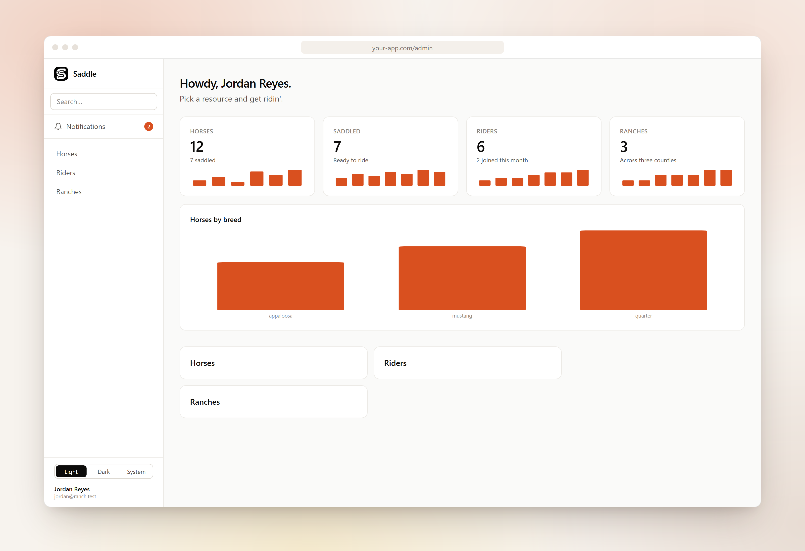
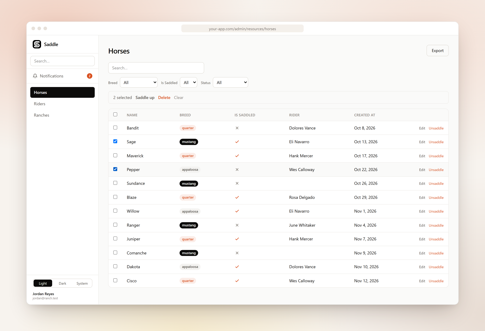
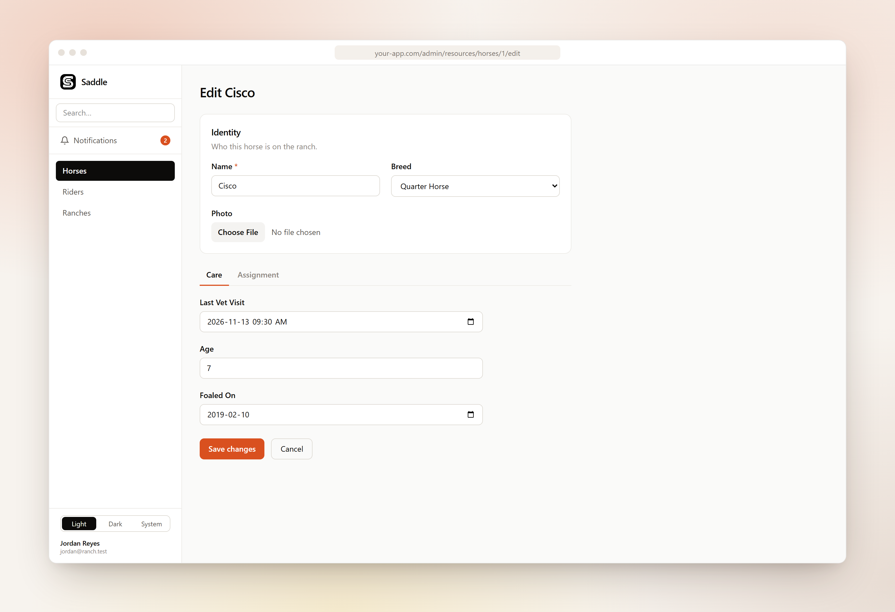

<p align="center">
  <picture>
    <source media="(prefers-color-scheme: dark)" srcset="../../art/logo-dark.png">
    
  </picture>
</p>

<h3 align="center">El framework de paneles de administración de código abierto para Laravel, creado para Inertia y Vue.</h3>

<p align="center">
  <a href="../sections/getting-started.md"><b>Documentación</b></a> ·
  <a href="https://packagist.org/packages/saddlephp/saddlephp"><b>Packagist</b></a> ·
  <a href="https://github.com/SaddlePHP/saddlephp/releases"><b>Novedades</b></a> ·
  <a href="../../CONTRIBUTING.md"><b>Contribuir</b></a>
</p>

<p align="center">
  <a href="README.ar.md">العربية</a> •
  <a href="README.de.md">Deutsch</a> •
  <a href="../../README.md">English</a> •
  <b>Español</b> •
  <a href="README.fr.md">Français</a> •
  <a href="README.it.md">Italiano</a> •
  <a href="README.ja.md">日本語</a> •
  <a href="README.ko.md">한국어</a> •
  <a href="README.nl.md">Nederlands</a> •
  <a href="README.pl.md">Polski</a> •
  <a href="README.pt-BR.md">Português (BR)</a> •
  <a href="README.ru.md">Русский</a> •
  <a href="README.tr.md">Türkçe</a> •
  <a href="README.zh-CN.md">简体中文</a>
</p>

<br>

<p align="center">
  <picture>
    <source media="(prefers-color-scheme: dark)" srcset="../../.github/screenshots/dashboard-dark.png">
    
  </picture>
</p>

<p align="center"><em>Ensilla tu caballo, vaquero: hay un nuevo panel de administración en el pueblo.</em></p>

## ¿Qué es Saddle?

Saddle convierte tus modelos de Eloquent en un panel de administración pulido. Describes cada modelo una sola vez, como una clase de recurso PHP con un formulario y una tabla, y Saddle genera las pantallas de listado, creación, edición y vista, además de la búsqueda, los filtros y las acciones. Renderiza con Inertia y Vue, aprovecha el inicio de sesión y las políticas que ya tiene tu aplicación Laravel, y no interfiere con el resto de tu app.

<table>
<tr>
<td width="50%" valign="middle">

### Tablas que hacen el trabajo

Columnas ordenables y con búsqueda, con insignias y valores booleanos, filtros, acciones por fila y acciones masivas con confirmación. Exporta la vista actual a CSV o importa un CSV pasando por la misma validación que usa tu formulario.

[Tablas y columnas →](../sections/tables.md)

</td>
<td width="50%">
<picture>
  <source media="(prefers-color-scheme: dark)" srcset="../../.github/screenshots/table-dark.png">
  
</picture>
</td>
</tr>
<tr>
<td width="50%">
<picture>
  <source media="(prefers-color-scheme: dark)" srcset="../../.github/screenshots/form-dark.png">
  
</picture>
</td>
<td width="50%" valign="middle">

### Formularios con un diseño de verdad

Once tipos de campo, desde texto y listas de selección hasta selectores de relaciones con búsqueda, subida de archivos y Markdown. Organízalos en secciones, cuadrículas y pestañas. La validación, la visibilidad y el guardado se basan en las mismas definiciones de campo.

[Campos →](../sections/fields.md) · [Diseño de formularios →](../sections/forms-layout.md)

</td>
</tr>
<tr>
<td width="50%" valign="middle">

### Una clase por modelo

Un recurso es PHP sin más. Colócalo en `app/Saddle/` y se detecta al arrancar: no hay rutas, controladores ni archivos Vue que escribir. El acceso sigue tus políticas de Laravel y está cerrado por defecto.

[Recursos →](../sections/resources.md) · [Autorización →](../sections/authorization.md)

</td>
<td width="50%">

```php
class HorseResource extends Resource
{
    public static string $model = Horse::class;

    public static function form(Form $form): Form
    {
        return $form->schema([
            Text::make('name')->required(),
            BelongsTo::make('rider')->searchable(),
            Toggle::make('is_saddled'),
        ]);
    }

    public static function table(Table $table): Table
    {
        return $table->columns([
            TextColumn::make('name')->sortable()->searchable(),
            BooleanColumn::make('is_saddled'),
        ]);
    }
}
```

</td>
</tr>
</table>

## Características

<table>
<tr>
<td width="33%" valign="top">

**Recursos**
- Clases de recurso detectadas automáticamente
- Páginas de listado, creación, edición y vista de solo lectura
- Generador `saddle:resource`
- Carga anticipada (eager loading) y columnas de relaciones

</td>
<td width="33%" valign="top">

**Formularios**
- Texto, contraseña, área de texto, número, selección, interruptor
- Fecha, fecha y hora, Markdown, subida de archivos
- Selector `BelongsTo` con búsqueda
- Secciones, cuadrículas y pestañas

</td>
<td width="33%" valign="top">

**Tablas**
- Columnas de texto, insignia y booleanas
- Ordenación, búsqueda y `formatUsing`
- Filtros de selección y booleanos
- Paginación

</td>
</tr>
<tr>
<td valign="top">

**Acciones**
- Acciones por fila y acciones masivas
- Diálogos de confirmación
- Comprobación de políticas por registro
- Ejecuciones masivas dentro de transacciones

</td>
<td valign="top">

**Relaciones**
- Gestores de relaciones `HasMany`
- Crea, edita y elimina registros relacionados sin salir de la página
- Limitados al registro padre

</td>
<td valign="top">

**Panel principal**
- Widgets de estadísticas con minigráficos
- Widgets de gráficos
- Notificaciones en base de datos con campana
- Búsqueda global en todos los recursos

</td>
</tr>
<tr>
<td valign="top">

**Acceso**
- Políticas estándar de Laravel
- Cerrado por defecto
- Visibilidad por campo con `canSee`
- Usa tu inicio de sesión actual

</td>
<td valign="top">

**Multiinquilino**
- Inquilinos definidos por la URL (`/admin/{tenant}`)
- Filtrado automático de consultas y asignación del inquilino
- Selector de inquilino y autorregistro
- Punto de enganche de acceso para facturación

</td>
<td valign="top">

**Datos**
- Exportación a CSV de la vista actual
- Importación de CSV con la validación del formulario
- Borrado lógico con restauración y borrado definitivo

</td>
</tr>
<tr>
<td valign="top">

**Apariencia e idioma**
- Temas claro, oscuro y del sistema
- Nombre de marca, color de acento y tokens de tema
- Panel traducido a 14 idiomas
- Compatibilidad con nonces de CSP

</td>
<td valign="top">

**Plugins**
- Paquetes de Composer normales y corrientes
- Campos y columnas personalizados como web components
- Hooks para props compartidas, navegación y tokens de tema

</td>
<td valign="top">

**Experiencia de desarrollo**
- Utilidades de pruebas para Pest y PHPUnit
- `saddle:install` y `saddle:upgrade`
- Aviso de assets desactualizados tras actualizar
- Laravel 11, 12 y 13

</td>
</tr>
</table>

## Construido con

<p>
  
  
  
  
  
  
</p>

## Inicio rápido

Requiere PHP 8.4+ y Laravel 11.48+, 12 o 13.

```bash
composer require saddlephp/saddlephp
php artisan saddle:install
php artisan saddle:resource HorseResource --model=Horse
```

Inicia sesión con el login de tu aplicación, registra una política para el modelo y visita `/admin`. Ejecuta `php artisan saddle:upgrade` después de cada actualización del paquete. La [guía de inicio](../sections/getting-started.md) recorre cada paso.

## Más información

| | |
|---|---|
| **Desarrollo** | [Recursos](../sections/resources.md) · [Campos](../sections/fields.md) · [Diseño de formularios](../sections/forms-layout.md) · [Tablas](../sections/tables.md) · [Filtros](../sections/filters.md) · [Acciones](../sections/actions.md) · [Gestores de relaciones](../sections/relations.md) |
| **Panel** | [Widgets del panel principal](../sections/widgets.md) · [Búsqueda global](../sections/search.md) · [Notificaciones](../sections/notifications.md) · [Borrado lógico](../sections/soft-deletes.md) · [Importación y exportación](../sections/import-export.md) |
| **Puesta en marcha** | [Autorización](../sections/authorization.md) · [Multiinquilino](../sections/tenancy.md) · [Extras de multiinquilino](../sections/tenancy-extras.md) · [Configuración](../sections/configuration.md) · [Temas](../sections/theming.md) · [Localización](../sections/i18n.md) |
| **Extensión** | [Plugins](../sections/plugins.md) · [Utilidades de pruebas](../sections/testing.md) · [Contribuir](../../CONTRIBUTING.md) · [Seguridad](../../SECURITY.md) |

## Licencia

Saddle es software de código abierto distribuido bajo la [licencia MIT](../../LICENSE).
