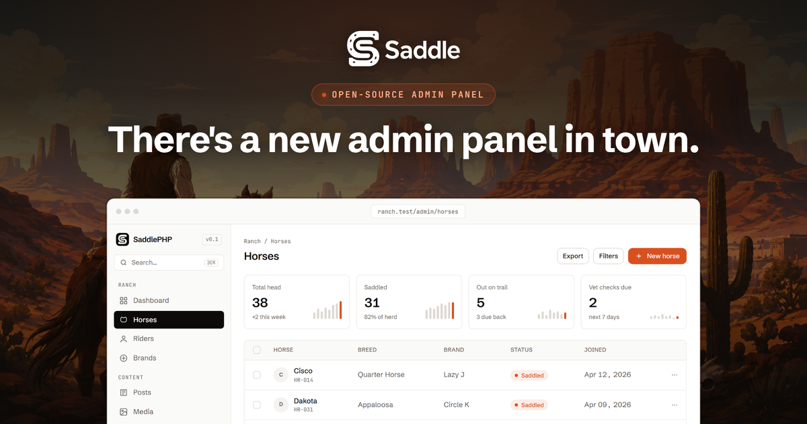

<p align="center">
  
</p>

<h3 align="center">面向 Laravel 的开源后台管理面板框架，专为 Inertia 和 Vue 打造。</h3>

<p align="center">
  <a href="../sections/getting-started.md"><b>文档</b></a> ·
  <a href="https://packagist.org/packages/saddlephp/saddlephp"><b>Packagist</b></a> ·
  <a href="https://github.com/SaddlePHP/saddlephp/releases"><b>更新日志</b></a> ·
  <a href="../../CONTRIBUTING.md"><b>参与贡献</b></a>
</p>

<p align="center">
  <a href="README.ar.md">العربية</a> •
  <a href="README.de.md">Deutsch</a> •
  <a href="../../README.md">English</a> •
  <a href="README.es.md">Español</a> •
  <a href="README.fr.md">Français</a> •
  <a href="README.it.md">Italiano</a> •
  <a href="README.ja.md">日本語</a> •
  <a href="README.ko.md">한국어</a> •
  <a href="README.nl.md">Nederlands</a> •
  <a href="README.pl.md">Polski</a> •
  <a href="README.pt-BR.md">Português (BR)</a> •
  <a href="README.ru.md">Русский</a> •
  <a href="README.tr.md">Türkçe</a> •
  <b>简体中文</b>
</p>

## Saddle 是什么？

Saddle 能把你的 Eloquent 模型变成一个精致的后台管理面板。每个模型只需描述一次，写成一个带表单和表格的 PHP 资源类，Saddle 就会为你生成列表、创建、编辑和查看页面，以及搜索、筛选和操作。界面由 Inertia 和 Vue 渲染，直接沿用你现有的 Laravel 登录和策略（Policy），也不会干扰应用的其他部分。

<table>
<tr>
<td width="50%" valign="middle">

### 真正好用的表格

支持排序和搜索的列，可显示徽章和布尔值，另有筛选器、行操作，以及带确认的批量操作。可以把当前视图导出为 CSV，也可以导入 CSV，并且走的是与表单相同的验证规则。

[表格与列 →](../sections/tables.md)

</td>
<td width="50%">
<picture>
  <source media="(prefers-color-scheme: dark)" srcset="../../.github/screenshots/table-dark.png">
  
</picture>
</td>
</tr>
<tr>
<td width="50%">
<picture>
  <source media="(prefers-color-scheme: dark)" srcset="../../.github/screenshots/form-dark.png">
  
</picture>
</td>
<td width="50%" valign="middle">

### 布局灵活的表单

十一种字段类型，从文本和下拉选择，到可搜索的关联选择器、文件上传和 Markdown。可以用分区、网格和标签页来组织它们。验证、可见性和保存都基于同一套字段定义。

[字段 →](../sections/fields.md) · [表单布局 →](../sections/forms-layout.md)

</td>
</tr>
<tr>
<td width="50%" valign="middle">

### 一个模型一个类

资源就是普通的 PHP 类。把它放进 `app/Saddle/`，启动时就会被自动发现：无需编写路由、控制器或 Vue 文件。访问权限遵循你的 Laravel 策略，并且默认关闭。

[资源 →](../sections/resources.md) · [授权 →](../sections/authorization.md)

</td>
<td width="50%">

```php
class HorseResource extends Resource
{
    public static string $model = Horse::class;

    public static function form(Form $form): Form
    {
        return $form->schema([
            Text::make('name')->required(),
            BelongsTo::make('rider')->searchable(),
            Toggle::make('is_saddled'),
        ]);
    }

    public static function table(Table $table): Table
    {
        return $table->columns([
            TextColumn::make('name')->sortable()->searchable(),
            BooleanColumn::make('is_saddled'),
        ]);
    }
}
```

</td>
</tr>
</table>

## 功能特性

<table>
<tr>
<td width="33%" valign="top">

**资源**
- 自动发现的资源类
- 列表、创建、编辑和只读查看页面
- `saddle:resource` 生成器
- 预加载与关联列

</td>
<td width="33%" valign="top">

**表单**
- 文本、密码、多行文本、数字、下拉选择、开关
- 日期、日期时间、Markdown、文件上传
- 可搜索的 `BelongsTo` 选择器
- 分区、网格和标签页

</td>
<td width="33%" valign="top">

**表格**
- 文本列、徽章列和布尔列
- 排序、搜索和 `formatUsing`
- 选择筛选器和布尔筛选器
- 分页

</td>
</tr>
<tr>
<td valign="top">

**操作**
- 行操作和批量操作
- 确认对话框
- 逐条记录的策略检查
- 在事务中执行批量操作

</td>
<td valign="top">

**关联**
- `HasMany` 关联管理器
- 就地创建、编辑和删除关联记录
- 限定在父记录范围内

</td>
<td valign="top">

**仪表盘**
- 带迷你图表的统计小组件
- 图表小组件
- 带铃铛提醒的数据库通知
- 跨资源的全局搜索

</td>
</tr>
<tr>
<td valign="top">

**访问控制**
- 标准 Laravel 策略
- 默认拒绝访问
- 通过 `canSee` 控制单个字段的可见性
- 沿用你现有的登录

</td>
<td valign="top">

**多租户**
- 基于 URL 的租户范围（`/admin/{tenant}`）
- 自动限定查询范围并写入租户标识
- 租户切换器与自助注册
- 用于计费的访问控制钩子

</td>
<td valign="top">

**数据**
- 将当前视图导出为 CSV
- 通过表单验证导入 CSV
- 支持恢复和强制删除的软删除

</td>
</tr>
<tr>
<td valign="top">

**外观与语言**
- 浅色、深色和跟随系统主题
- 品牌名称、强调色和主题令牌
- 面板已翻译为 14 种语言
- 支持 CSP nonce

</td>
<td valign="top">

**插件**
- 普通的 Composer 包
- 以 Web Components 形式提供自定义字段和列
- 用于共享 props、导航和主题令牌的钩子

</td>
<td valign="top">

**开发体验**
- Pest 和 PHPUnit 测试辅助工具
- `saddle:install` 和 `saddle:upgrade`
- 升级后提示前端资源已过期
- 支持 Laravel 11、12 和 13

</td>
</tr>
</table>

## 技术栈

<p>
  
  
  
  
  
  
</p>

## 快速开始

需要 PHP 8.4+ 以及 Laravel 11.48+、12 或 13。

```bash
composer require saddlephp/saddlephp
php artisan saddle:install
php artisan saddle:resource HorseResource --model=Horse
```

通过应用自身的登录页登录，为模型注册一个策略，然后访问 `/admin`。每次更新扩展包后，运行 `php artisan saddle:upgrade`。[入门指南](../sections/getting-started.md)会逐步讲解每个环节。

## 了解更多

| | |
|---|---|
| **构建** | [资源](../sections/resources.md) · [字段](../sections/fields.md) · [表单布局](../sections/forms-layout.md) · [表格](../sections/tables.md) · [筛选器](../sections/filters.md) · [操作](../sections/actions.md) · [关联管理器](../sections/relations.md) |
| **面板** | [仪表盘小组件](../sections/widgets.md) · [全局搜索](../sections/search.md) · [通知](../sections/notifications.md) · [软删除](../sections/soft-deletes.md) · [导入与导出](../sections/import-export.md) |
| **运行** | [授权](../sections/authorization.md) · [多租户](../sections/tenancy.md) · [多租户进阶](../sections/tenancy-extras.md) · [配置](../sections/configuration.md) · [主题](../sections/theming.md) · [本地化](../sections/i18n.md) |
| **扩展** | [插件](../sections/plugins.md) · [测试辅助工具](../sections/testing.md) · [参与贡献](../../CONTRIBUTING.md) · [安全](../../SECURITY.md) |

## 许可证

Saddle 是基于 [MIT 许可证](../../LICENSE)发布的开源软件。
